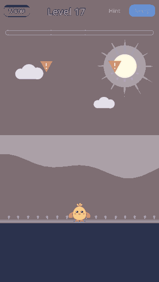
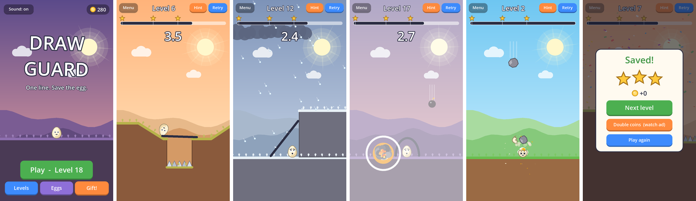

# Draw Guard

Draw **one line** to keep the egg safe. Lift your finger and the line turns solid: rocks fall, bombs go off, hail pours down and the wind blows. If the egg is still whole when the clock runs out, you win. The less ink you use, the more stars you get.





## Features

- 30 levels in 6 chapters, with something new every 5 levels: falling rocks, slopes and spikes, hail, bombs, wind, two eggs at once
- Many ways to win a level: a dome, a bridge, a lid, a lean-to, a roof between two posts
- 3 stars per level, based on how much ink you used; the ink bar shows where each star is lost
- Hints (40 coins, or a rewarded ad) that trace one winning line; "skip level" after 3 failed tries
- Daily gift with a 7-day streak, coins, and 6 egg skins to buy
- The egg has feelings: it wobbles like jelly, looks at danger, sweats and shakes when scared, jumps when saved, and cracks open with the shell flying off
- Dust, screen shake, speed lines, explosions with shock waves, confetti, swaying grass, drifting clouds
- The home screen plays a level by itself
- Sound effects generated in code (no audio files), vibration on Android
- Progress saved on the device
- Uses the Compatibility renderer, so it runs on low-end phones and in the browser

## Controls

Drag a finger (or the mouse) to draw. The level starts when you lift it.

## Run it

**On a PC:** install Godot 4.3 or newer, open Godot, choose *Import*, select `draw-guard/project.godot`, then press Play (F5).

**On an Android phone:** install *Godot Engine* from the Play Store, copy the `draw-guard` folder to the phone, import `project.godot` in the app, then press Play.

## Make an APK

In Godot: *Editor → Manage Export Templates → Download*, then *Project → Export → Android → Export Project*. The Android SDK/JDK must be set in *Editor Settings → Export → Android*. An Android and a Web preset are already included.

## Ads

**The game does not show real ads yet.** Every ad call goes through `ads.gd`, which shows a short "test screen" and then gives the reward. To earn money, add an AdMob plugin for Godot 4 to the Android export and replace the two `_show_placeholder` calls in `ads.gd` with the plugin's rewarded and interstitial calls.

Where ads are asked for:

| Ad | When |
|---|---|
| Rewarded | Hint, skip level, double the coins after a win (always the player's choice) |
| Full-screen | Between levels: never in levels 1-5, then once every 3 wins (`FREE_LEVELS`, `WINS_PER_AD` in `ads.gd`) |

## Code

| File | What it does |
|---|---|
| `main.gd` | Menus, level list, skins, daily gift, popups, saving |
| `game.gd` | One level: drawing the line, physics, hazards, effects |
| `egg.gd` | The egg: physics body, faces, cracking, skins |
| `levels.gd` | The 30 levels as data, with helpers for common shapes |
| `ads.gd` | The one place ads are requested |
| `sfx.gd` | Sound effects made in code |

### Adding a level

Add a dictionary to `levels.gd` (the format is described at the top of the file). Every level stores one winning line, `sol`; the hint shows it and the star limits are worked out from its length. Then check that every level can be won with its line and is lost with no line:

```
godot --headless --fixed-fps 2 --path . -s tools/check_levels.gd
```

`tools/screenshot.gd` saves pictures or a frame-by-frame clip of any level.
