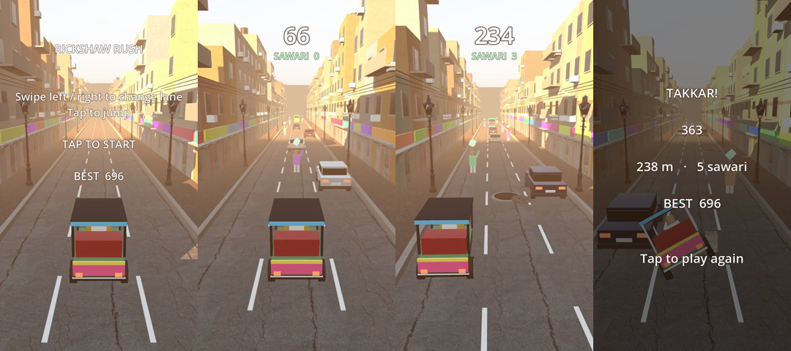

# Rickshaw Rush 3D

Drive a rickshaw through a busy street. It speeds up the longer you survive. Dodge traffic, jump potholes, and pick up passengers (sawari) for bonus points.

## Controls

| Action | Phone | PC |
|---|---|---|
| Change lane | Swipe left / right | ← → or A / D |
| Jump | Tap or swipe up | ↑, W or Space |

## Obstacles

| Obstacle | What to do |
|---|---|
| Car, bus, buffalo | Change lane |
| Open manhole, concrete police barrier | Jump |
| Passenger (green marker) | Drive into them: +25 points |

Score = distance in metres + 25 for every passenger. The best score is saved on the device.

## Features

- Photo-scanned CC0 textures and models from Poly Haven: cracked asphalt, brick footpath, plaster walls, rolling shop shutters, street lamps, concrete barriers, manhole covers ([credits](assets/CREDITS.md))
- HDR sunset sky that also lights the scene and shows up in reflections on car paint and glass
- Buildings with windows, balconies, AC units, sign boards, rooftop water tanks and overhead wires
- Each road tile's static geometry is merged into one mesh, so it stays smooth on phones and in the browser
- Rickshaw with truck-art colours, chrome trim, spinning wheels, lean on lane changes and a nose-up jump
- Speed and field of view rise over time; obstacle rows get denser with distance
- Sound effects generated in code, vibration on Android
- Compatibility renderer, so it runs on low-end phones and in the browser

## Run it

**On a PC:** install Godot 4.3 or newer, choose *Import*, select `rickshaw-rush/project.godot`, then press Play (F5).

**On an Android phone:** install *Godot Engine* from the Play Store, copy the `rickshaw-rush` folder to the phone, import `project.godot` in the app, then press Play.

## Make an APK

In Godot: *Editor → Manage Export Templates → Download*, then *Project → Export → Android → Export Project*. The Android SDK/JDK must be set in *Editor Settings → Export → Android*. Android and Web presets are included.

## Tuning

Everything is in `main.gd`. Change the constants at the top (`START_SPEED`, `MAX_SPEED`, `ACCEL`, `JUMP_VELOCITY`, `PASSENGER_POINTS`, ...), or the obstacle mix in `_pick_kind()`.
