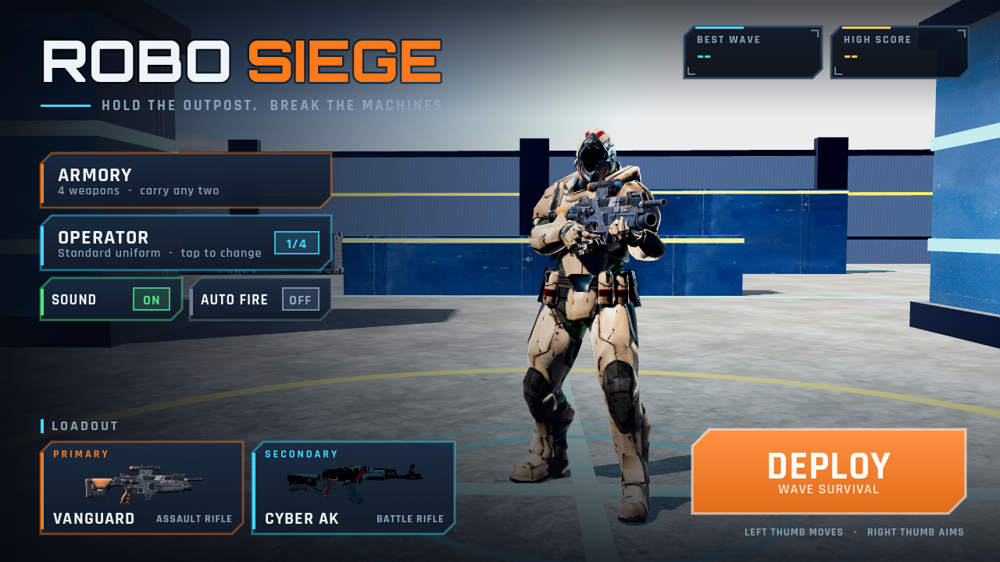
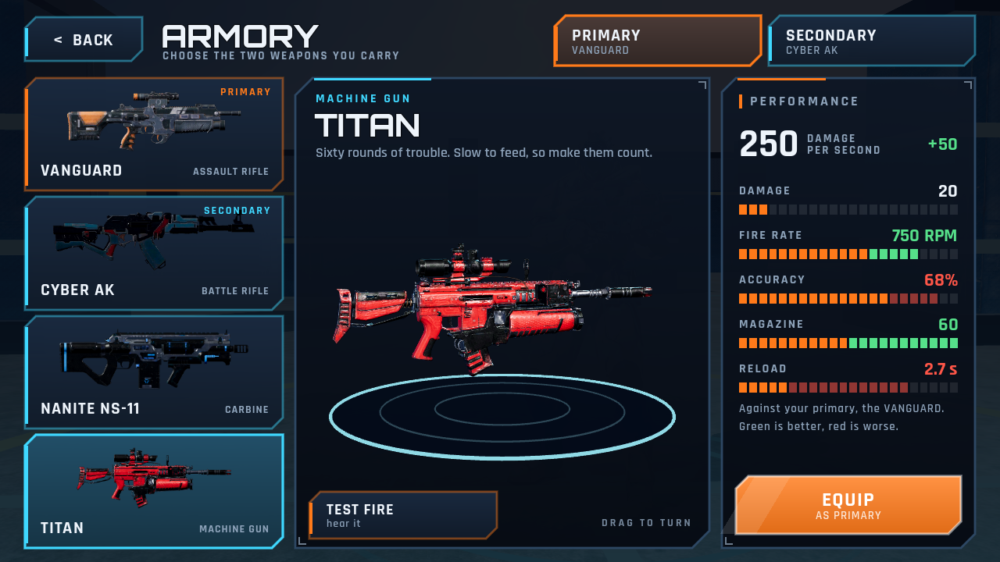
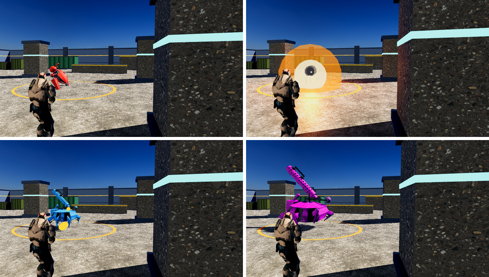

# Robo Siege 3D

A third-person shooter. You are a trooper holding a landing platform against waves of enemy troopers. Shoot, throw grenades, dash out of the way, and pick one upgrade after every wave. See how many waves you can survive.









## Features

- **Four rifles**, each its own detailed model, sound and feel: the Vanguard assault rifle, the Cyber AK, the Nanite NS-11 carbine and the Titan machine gun
- A **lobby** where the trooper stands in the outpost holding the weapon chosen, with the loadout, the uniform and the settings one tap away
- An **armory**: the weapon turns on a stand and can be dragged round with a finger; its damage per second, damage, fire rate, accuracy, magazine and reload are set against the weapon it would replace, green where it is better and red where it is worse; and a TEST FIRE button plays how it sounds before you choose it
- Carry two and swap between them mid-fight
- A rigged, animated trooper who really holds the rifle: the butt is in the shoulder, the right hand is closed round the grip with a finger on the trigger, the left is under the barrel with its fingers up the far side, and both stay there wherever the weapon points
- The enemies are the same trooper in other colours, at other sizes, carrying the other rifles, so the whole fight belongs to one world:
  - **Scout** walks into range, sidesteps and fires single shots
  - **Rusher** charges and blows itself up
  - **Gunner** is taller, wears shoulder armour and fires bursts
  - **War Machine** is the boss, head and shoulders above the rest, every fifth wave
- Sound made from real recordings: every weapon has four takes of its own shot, enemy fire comes from where the enemy is and fades with distance, and footsteps land when the feet do, soft at a walk and hard at a run
- Over-the-shoulder camera that pulls in when a wall is behind you
- Enemies find their way round cover, warn before they fire, and their bolts are slow enough to dodge
- Recoil and spread that grows while you hold the trigger, head shots for double damage, grenades, and a dash during which nothing can hurt you
- Armour repairs itself after a few quiet seconds
- Seven upgrades; choose one of three after each wave. They multiply the weapon's own numbers, so they carry across when you swap
- Aim assist and optional auto fire, so it plays well with thumbs
- A landing platform of metal decking with lit seams, tech columns, blast barriers and real sci-fi cargo, under a photographed sky that lights the whole scene
- Four uniforms for your trooper, chosen in the lobby
- Enemies fall where they are hit and sink away; tracers, sparks, explosions, damage numbers, screen shake, hit markers, a radar and arrows showing where you were hit from
- Best wave and score saved on the device
- Uses the Compatibility renderer, so it runs on phones and in the browser

## Controls

| | Touch | Keyboard and mouse |
|---|---|---|
| Move | Left side of the screen (a stick appears under your thumb) | W A S D |
| Aim | Drag on the right side | Mouse |
| Fire | FIRE button (you can aim while holding it) | Left click |
| Reload | LOAD | R |
| Grenade | BOMB | G or right click |
| Dash | DASH | Space or Shift |
| Swap weapon | SWAP | Q or Tab |
| Pause | Top-right button | Esc or P |

With **Auto fire** on (the default on a touch screen) the trooper fires whenever the sights are on a robot.

## Run it

**On a PC:** install Godot 4.3 or newer, open Godot, choose *Import*, select `robo-siege/project.godot`, then press Play (F5).

**On an Android phone:** install *Godot Engine* from the Play Store, copy the `robo-siege` folder to the phone, import `project.godot` in the app, then press Play.

## Make an APK

In Godot: *Editor → Manage Export Templates → Download*, then *Project → Export → Android → Export Project*. The Android SDK/JDK must be set in *Editor Settings → Export → Android*. An Android and a Web preset are already included.

## Code

| File | What it does |
|---|---|
| `main.gd` | Waves, upgrades, score, saving, and which screen is showing |
| `lobby.gd` | The first screen: title, loadout, uniform, settings, DEPLOY |
| `armory.gd` | The weapons screen: the list, the showpiece, the figures, EQUIP |
| `ui.gd`, `ui/` | The look of every screen: colours, type, and the drawn parts (plate, button, meter, upgrade card, 3D weapon view) |
| `hud.gd` | Touch and keyboard controls, and everything drawn over the fight |
| `player.gd` | The trooper: moving, the camera, shooting, grenades, dash |
| `enemy.gd` | The robots and how each kind behaves |
| `arena.gd` | The outpost, its lighting, and the grid robots use to find their way |
| `rig.gd` | The trooper body everyone wears: animations, the shooting stance, how the hands hold the weapon, the uniform, and the colour schemes (`LOOKS`, `ENEMY_LOOKS`) |
| `robot.gd` | The enemies: each kind's size, colour, weapon and shoulder armour, built on the same trooper |
| `weapons.gd` | The four weapons: model, where it is held, sound and numbers |
| `fx.gd` | Tracers, sparks, explosions, damage numbers, bolts and grenades |
| `sfx.gd` | Sound: the mixer, the voices, and which recording each name plays |

Tuning: robot health, speed and damage are in `STATS` at the top of `enemy.gd`; the trooper's numbers are at the top of `player.gd`; what each wave contains is `_wave_list` in `main.gd`; cover is the `COVER` list in `arena.gd`; how the hands sit on a weapon is `TRIGGER_HAND` and `SUPPORT_HAND` at the top of `rig.gd`.

### Adding a weapon

1. Put the downloaded `.glb` in a folder and add it to `MODELS` in `tools/import_rifles.py`, with how far it must be turned to bring its muzzle round to +X. Run the script; it joins the parts, turns the model, thins very dense meshes, shrinks the textures to 512 pixels and writes `assets/guns/<name>.glb`.
2. Add an entry to `LIST` in `weapons.gd`.
3. Run `tools/gun_shots.gd`. It draws the weapon from the side with three dots: green where the trigger hand holds it (`grip`), blue where the other hand does (`fore`), red where bullets leave (`bore`). Move the numbers until the dots are on the grip, under the barrel and on the muzzle.
4. Run `tools/hero_shots.gd` to see the trooper holding it from every side.

### Art

| What | From | Licence |
|---|---|---|
| The trooper, worn by the player and every enemy (`assets/soldier.glb`) | The "Soldier" model from the [three.js examples](https://github.com/mrdoob/three.js/tree/dev/examples/models/gltf), originally from [Mixamo](https://www.mixamo.com) | Mixamo terms |
| The trooper's uniform (`assets/hero`) | Made by `tools/build_hero_textures.py` from the two pictures inside that model | as the model |
| The four rifles (`assets/guns`) | Models supplied for this project, downloaded from Sketchfab: "Assault Rifle PBR", "Cyber AK Rifle", "Nanite Systems Assault Rifle" and "Semi Sci-Fi Assault Rifle (Free)"; made game-ready by `tools/import_rifles.py` | see note below |
| Cargo, barrels, lockers, shelves, satellite dishes (`assets/scifi`) | [Sci-Fi Essentials Kit](https://opengameart.org/content/sci-fi-essentials-kit) by Quaternius | CC0 |
| Sky (`assets/sky`) | [Kloofendal 43d Clear (Pure Sky)](https://polyhaven.com/a/kloofendal_43d_clear_puresky) | CC0 |
| Decking and panels (`assets/textures`) | [Poly Haven](https://polyhaven.com): `concrete_floor_02`, `blue_metal_plate` | CC0 |
| Type (`assets/fonts`) | [Rajdhani](https://fonts.google.com/specimen/Rajdhani) and [Orbitron](https://fonts.google.com/specimen/Orbitron) | SIL Open Font Licence (both licences are in the folder) |

The sky is both the background and the light: the sun, the shadows and the reflections all come from that one photograph.

**Before publishing the game, check the licence of each rifle model on its Sketchfab page.** Sketchfab models carry the licence their author chose (usually one of the Creative Commons ones, most of which ask for the author to be credited, and some of which do not allow commercial use). They were supplied as files, without their licence pages, so this has not been checked here.

Mixamo characters may be used in games, including commercial ones, free of charge; they may not be passed on by themselves as assets. If that matters for where this repository is published, download your own copy from mixamo.com and replace the file.

**The uniform.** The model comes with a colour picture and a normal map and nothing to say what any of it is made of, so on its own it renders as if it were chalk. `tools/build_hero_textures.py` tells what each pixel is from its colour (cream and red are paint, green is cloth, near-black is the rubber suit, blue-grey is metal, the dark chips in the paint are bare metal) and writes three pictures at twice the size: the colours, sharpened, with the weave of the cloth drawn in; the bumps, with fine ones added for each material; and one saying how rough and how metallic each part is and where the creases are in shadow.

### Sounds

Every sound is a recording in `assets/sounds`.

| Sound | Files | From | By |
|---|---|---|---|
| Your weapons | `rifle_shot*`, `ak_shot*`, `carbine_shot*`, `heavy_shot*`, `reload`, `reload_heavy` | Recordings supplied for this project (AK-47, M249, P90 and machine-gun bursts, plus two reloads) | see note below |
| Enemy weapons | `enemy_scout_shot*`, `enemy_gunner_shot*`, `enemy_boss_shot*` | The rest of the supplied recordings (a machine gun, a .50 calibre, a submachine gun) | see note below |
| Footsteps | `step_walk*`, `step_run*` | A supplied recording of footsteps on concrete | see note below |
| Grenade and big explosions | `boom` | [Chunky Explosion](https://opengameart.org/content/chunky-explosion) | Joth |
| Machines breaking | `kill1`-`2`, `hit3` | [Sci-Fi Sounds](https://opengameart.org/content/sci-fi-sounds) | Kenney |
| Bullets hitting robots | `hit1`-`2` | [100 CC0 SFX](https://opengameart.org/content/100-cc0-sfx) | rubberduck |
| Rusher beep | `beep` | [50 CC0 Sci-Fi SFX](https://opengameart.org/content/50-cc0-sci-fi-sfx) | rubberduck |
| Trooper hurt | `hurt1`-`3` | [15 vocal male strain/hurt/pain/jump sounds](https://opengameart.org/content/15-vocal-male-strainhurtpainjump-sounds) | qubodup |
| Dash, grenade throw | `dash1`-`2`, `throw1`-`2` | [Swishes Sound Pack](https://opengameart.org/content/swishes-sound-pack) | artisticdude |
| Wave alarm | `wave` | [Short alarm](https://opengameart.org/content/short-alarm) | yd |
| Wave clear, game over, upgrade, repair kit | `clear`, `over`, `upgrade`, `pickup` | [Level up, power up, coin get (13 sounds)](https://opengameart.org/content/level-up-power-up-coin-get-13-sounds) | wobbleboxx |
| Buttons, empty magazine, weapon swap | `click`, `empty`, `swap` | [Interface Sounds](https://opengameart.org/content/interface-sounds) | Kenney |

Everything from [OpenGameArt](https://opengameart.org) in that table is CC0 (public domain). **The supplied recordings (weapons, reloads and footsteps) are not from those packs; check their own terms before publishing the game.** Their file names suggest they come from Pixabay, whose licence allows use in games, but that has not been checked here.

**How a shot is made.** The weapon recordings are bursts: many shots a few hundredths of a second apart. The game needs the opposite, one shot that rings out, which it plays once per bullet at the weapon's own rate. `tools/build_gun_sounds.py` cuts one shot's body out of the middle of a burst and joins it to what the recording does after its last shot, which is the only place a shot is heard dying away with nothing fired over it. Nothing is added and nothing is distorted: rumble no speaker can play is removed, a recording that is nearly all deep bass is rebalanced so a phone has a body to play, the tail is faded to true silence (which also takes the hiss off), and every weapon is brought to the same loudness. Four takes of each, one picked at random per shot.

**Footsteps** are cut from a long walk by `tools/build_step_sounds.py`: the ordinary steps for walking, the hardest landings for running. In the game a step is played when a foot actually comes down in the animation, so the sound matches the legs at any pace.

**The mixer** (`sfx.gd`). The trooper's weapon, the things heard out in the world and everything else each have voices of their own, so one cannot cut another off, and a limiter on the output turns the whole mix down together when many loud sounds land at once, instead of letting it crackle. One thing is worth knowing if you add sounds: the engine fades every sound in over its first hundredth of a second or two, which is exactly where the crack of a shot is. `sfx.gd` puts that much silence in front of every sound, so the fade is over before the sound begins.

`tools/build_sounds.py` made the everyday sounds from the downloaded packs: mono, 44.1 kHz, trimmed and levelled. A sound with several files is a set of takes.

### Tests

Three tests run with no screen.

`tools/sound_test.gd` checks that every sound the game asks for exists: each weapon's shot and reload, each kind of robot's fire, and every name written in the scripts.

```
godot --headless --path . -s tools/sound_test.gd
```

`tools/touch_test.gd` taps the screen the way a finger would. It opens the armory, picks a weapon, equips it, test-fires it, goes back, taps DEPLOY, then works the stick, FIRE, LOAD, BOMB, DASH, SWAP and pause, and checks that each one did something and that the shots and footsteps were heard:

```
godot --headless --fixed-fps 30 --path . -s tools/touch_test.gd
```

The game can also play itself. This runs about a minute and a half of play and checks that robots arrive in their own colours, can be destroyed, waves advance, upgrades apply, and that hundreds of shots and footsteps were played with no sound missing:

```
godot --headless --fixed-fps 4 --path . -s tools/smoke_test.gd
```

The tests use a save file of their own, so running them never changes a real one.

### Looking at it

These need a display (on a server: `xvfb-run`). Each saves pictures to the folder given after `--`.

| Tool | What it shows |
|---|---|
| `tools/ui_shots.gd` | Every screen: lobby, armory, the fight, pause, upgrades, game over |
| `tools/gun_shots.gd` | Each weapon from the side, with the three points it is held and fired by |
| `tools/hero_shots.gd` | The trooper holding a weapon, from every side, with close views of each hand |
| `tools/hold_shots.gd` | The same in plain light, with the muzzle marked |
| `tools/lineup_shot.gd` | The trooper and the four kinds of robot side by side |
| `tools/screenshot.gd` | The game playing itself, and frames for a GIF |
| `tools/record_audio.gd` | Not pictures: records what the game really sounds like, straight from its mixer, as a WAV |
