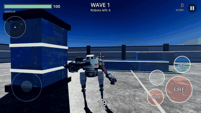
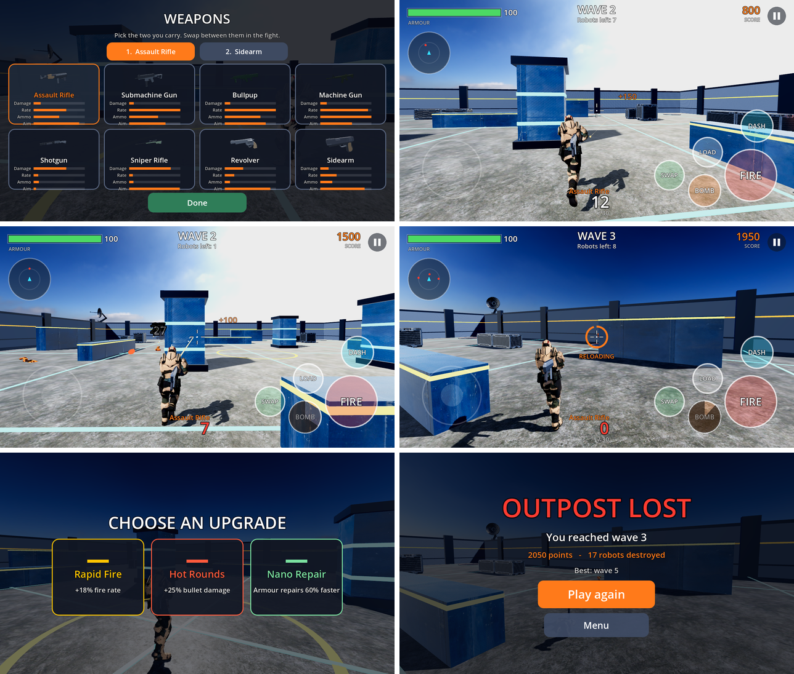
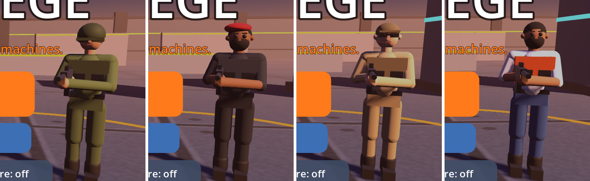

# Robo Siege 3D

A third-person shooter. You are a trooper holding an outpost against waves of robots. Shoot, throw grenades, dash out of the way, and pick one upgrade after every wave. See how many waves you can survive.







## Features

- A rigged, animated soldier model with idle, walk and run animations; the arms are bent in code so both hands hold the rifle wherever it points
- Four uniforms, chosen in the menu: Standard, Desert, Jungle and Night
- Robots are rigged models with their own walking, attacking and falling animations, each kind in its own colour
- A photographed sky lights the whole outpost, and the floor, walls, pillars, crates and containers are photographed concrete, steel and painted metal
- Over-the-shoulder camera that pulls in when a wall is behind you
- Four kinds of robot:
  - **Grunt** walks into range, sidesteps and fires single bolts
  - **Rusher** sprints at you and blows itself up; shoot it first
  - **Heavy** is slow and tough and fires bursts from two guns
  - **War Machine** is a boss that arrives every fifth wave
- Robots find their way round cover, warn before they fire (the eye glows), and their bolts are slow enough to dodge
- Rifle with recoil and spread, head shots for double damage, grenades, and a dash during which nothing can hurt you
- Armour repairs itself after a few quiet seconds
- Seven upgrades; choose one of three after each wave
- Aim assist and optional auto fire, so it plays well with thumbs
- Robots break into pieces; tracers, sparks, explosions, damage numbers, screen shake, hit markers, a radar and arrows showing where you were hit from
- Recorded sounds for everything: rifle, reload, explosions, robot guns, hits, footsteps, the trooper's voice, alarms and menus; vibration on Android
- Best wave and score saved on the device
- Uses the Compatibility renderer, so it runs on low-end phones and in the browser

## Controls

| | Touch | Keyboard and mouse |
|---|---|---|
| Move | Left side of the screen (a stick appears under your thumb) | W A S D |
| Aim | Drag on the right side | Mouse |
| Fire | FIRE button (you can aim while holding it) | Left click |
| Reload | LOAD | R |
| Grenade | BOMB | G or right click |
| Dash | DASH | Space or Shift |
| Pause | Top-right button | Esc or P |

With **Auto fire** on (the default on a touch screen) the trooper fires whenever the sights are on a robot.

## Run it

**On a PC:** install Godot 4.3 or newer, open Godot, choose *Import*, select `robo-siege/project.godot`, then press Play (F5).

**On an Android phone:** install *Godot Engine* from the Play Store, copy the `robo-siege` folder to the phone, import `project.godot` in the app, then press Play.

## Make an APK

In Godot: *Editor → Manage Export Templates → Download*, then *Project → Export → Android → Export Project*. The Android SDK/JDK must be set in *Editor Settings → Export → Android*. An Android and a Web preset are already included.

## Code

| File | What it does |
|---|---|
| `main.gd` | Menus, waves, upgrades, score, saving |
| `player.gd` | The trooper: moving, the camera, shooting, grenades, dash |
| `enemy.gd` | The robots and how each kind behaves |
| `arena.gd` | The outpost, its lighting, and the grid robots use to find their way |
| `rig.gd` | The soldier model, its arm reach and the uniforms (`LOOKS`) |
| `robot.gd` | The robot models: which model each kind uses, its colour, animations and gun points |
| `fx.gd` | Tracers, sparks, explosions, damage numbers, bolts and grenades |
| `hud.gd` | Touch and keyboard controls, and everything drawn over the game |
| `sfx.gd` | Sound: recordings from `assets/sounds` where they exist, otherwise made in code |

Tuning: robot health, speed and damage are in `STATS` at the top of `enemy.gd`; the trooper's numbers are at the top of `player.gd`; what each wave contains is `_wave_list` in `main.gd`; cover is the `COVER` list in `arena.gd`.

### Art

| What | From | Licence |
|---|---|---|
| Robots (`assets/models`) | [Robot Enemy Pack](https://opengameart.org/content/robot-enemy-pack) by Teh_Bucket, exported from the .blend files with `tools/export_bots.py` | CC0 |
| Sky (`assets/sky`) | [Kloofendal 43d Clear (Pure Sky)](https://polyhaven.com/a/kloofendal_43d_clear_puresky) | CC0 |
| Surfaces (`assets/textures`) | [Poly Haven](https://polyhaven.com): `concrete_floor_02`, `concrete_floor_01`, `factory_wall`, `metal_plate`, `container_side`, `rusty_corrugated_iron` | CC0 |

The sky is both the background and the light: the sun, the shadows and the reflections all come from that one photograph.

### The soldier model

`assets/soldier.glb` is the "Soldier" model from the [three.js examples](https://github.com/mrdoob/three.js/tree/dev/examples/models/gltf), which comes from [Mixamo](https://www.mixamo.com) (Adobe). Mixamo characters may be used in games, including commercial ones, free of charge; they may not be passed on by themselves as assets. If that matters for where this repository is published, download your own copy from mixamo.com and replace the file.

### Sounds

Every sound is a recording in `assets/sounds`. They all come from [OpenGameArt](https://opengameart.org) and are all CC0 (public domain): free to use, also commercially, with no credit required. They are credited here anyway.

| Sound | Files | From | By |
|---|---|---|---|
| Rifle | `shot1`-`shot4` | [The Free Firearm Sound Library](https://opengameart.org/content/the-free-firearm-sound-library): four single AK-47 shots | Still North Media, posted by bart |
| Reload | `reload` | [Gun reload sounds](https://opengameart.org/content/gun-reload-sounds) | SpringySpringo |
| Grenade and big explosions | `boom` | [Chunky Explosion](https://opengameart.org/content/chunky-explosion) | Joth |
| Robot guns, robots breaking | `enemy_shot1`-`3`, `kill1`-`2`, `hit3` | [Sci-Fi Sounds](https://opengameart.org/content/sci-fi-sounds) | Kenney |
| Bullets hitting robots | `hit1`-`2` | [100 CC0 SFX](https://opengameart.org/content/100-cc0-sfx) | rubberduck |
| Rusher beep | `beep` | [50 CC0 Sci-Fi SFX](https://opengameart.org/content/50-cc0-sci-fi-sfx) | rubberduck |
| Trooper hurt | `hurt1`-`3` | [15 vocal male strain/hurt/pain/jump sounds](https://opengameart.org/content/15-vocal-male-strainhurtpainjump-sounds) | qubodup |
| Footsteps | `step1`-`6` | [Fantozzi's Footsteps](https://opengameart.org/content/fantozzis-footsteps-grasssand-stone) | Fantozzi |
| Dash, grenade throw | `dash1`-`2`, `throw1`-`2` | [Swishes Sound Pack](https://opengameart.org/content/swishes-sound-pack) | artisticdude |
| Wave alarm | `wave` | [Short alarm](https://opengameart.org/content/short-alarm) | yd |
| Wave clear, game over, upgrade, repair kit | `clear`, `over`, `upgrade`, `pickup` | [Level up, power up, coin get (13 sounds)](https://opengameart.org/content/level-up-power-up-coin-get-13-sounds) | wobbleboxx |
| Buttons, empty magazine | `click`, `empty` | [Interface Sounds](https://opengameart.org/content/interface-sounds) | Kenney |

`tools/build_sounds.py` made the files from the downloaded packs: mono, 44.1 kHz, trimmed and levelled. A sound with several files is a set of takes; one is picked at random each time.

The rifle is the one sound that was reshaped rather than just trimmed. A raw gunshot recording is a single spike with a long quiet tail: thin on a phone speaker, and mush at nine shots a second. The script lifts the low mids and the bite, adds a short knock and crack, drives the result into a soft limit and cuts the tail to 0.3 s.

Delete a file and the game falls back to a sound it generates itself (`sfx.gd`).

### Tests

Two tests run with no screen.

`tools/touch_test.gd` taps the screen the way a finger would (PLAY, the stick, FIRE, LOAD, BOMB, DASH, pause) and checks that each one works:

```
godot --headless --fixed-fps 30 --path . -s tools/touch_test.gd
```

The game can also play itself. This runs about a minute and a half of play with no screen and checks that robots arrive, can be destroyed, waves advance and upgrades apply:

```
godot --headless --fixed-fps 4 --path . -s tools/smoke_test.gd
```

`tools/screenshot.gd` saves pictures of the game playing itself.
