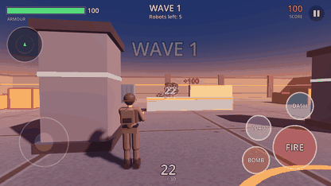
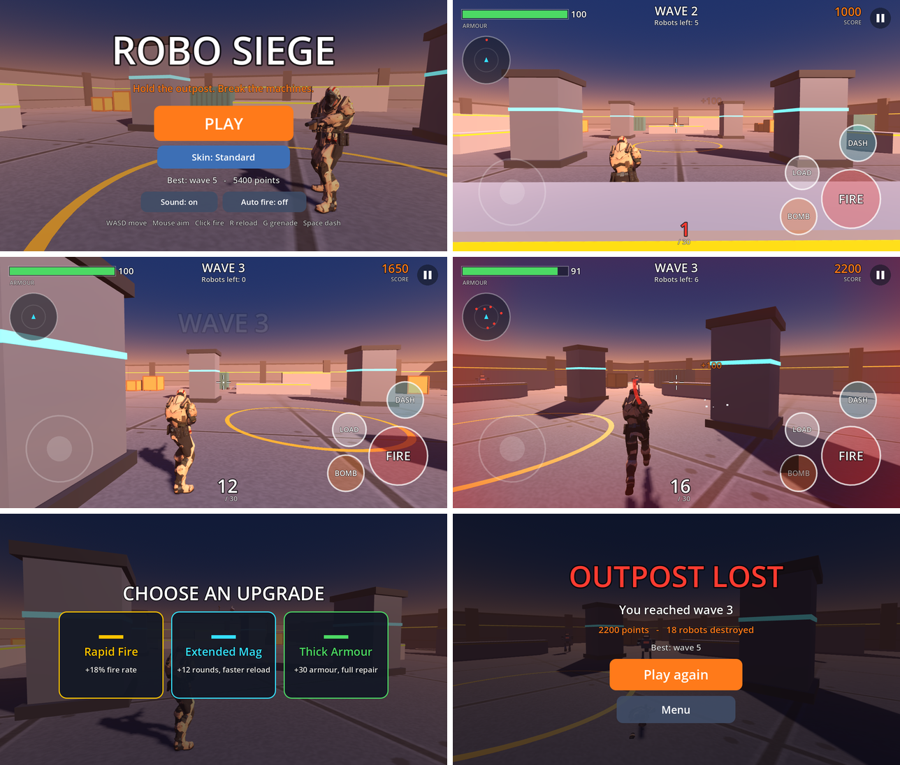
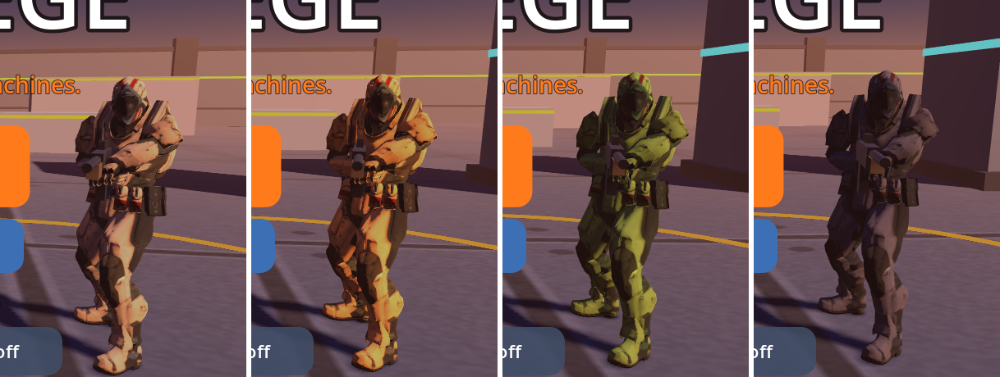

# Robo Siege 3D

A third-person shooter. You are a trooper holding an outpost against waves of robots. Shoot, throw grenades, dash out of the way, and pick one upgrade after every wave. See how many waves you can survive.







## Features

- A rigged, animated soldier model with idle, walk and run animations; the arms are bent in code so both hands hold the rifle wherever it points
- Four uniforms, chosen in the menu: Standard, Desert, Jungle and Night
- Over-the-shoulder camera that pulls in when a wall is behind you
- Four kinds of robot:
  - **Grunt** walks into range, sidesteps and fires single bolts
  - **Rusher** sprints at you and blows itself up; shoot it first
  - **Heavy** is slow and tough and fires bursts from two guns
  - **War Machine** is a boss that arrives every fifth wave
- Robots find their way round cover, warn before they fire (the eye glows), and their bolts are slow enough to dodge
- Rifle with recoil and spread, head shots for double damage, grenades, and a dash during which nothing can hurt you
- Armour repairs itself after a few quiet seconds
- Seven upgrades; choose one of three after each wave
- Aim assist and optional auto fire, so it plays well with thumbs
- Robots break into pieces; tracers, sparks, explosions, damage numbers, screen shake, hit markers, a radar and arrows showing where you were hit from
- Sound effects generated in code (no audio files), vibration on Android
- Best wave and score saved on the device
- Uses the Compatibility renderer, so it runs on low-end phones and in the browser

## Controls

| | Touch | Keyboard and mouse |
|---|---|---|
| Move | Left side of the screen (a stick appears under your thumb) | W A S D |
| Aim | Drag on the right side | Mouse |
| Fire | FIRE button (you can aim while holding it) | Left click |
| Reload | LOAD | R |
| Grenade | BOMB | G or right click |
| Dash | DASH | Space or Shift |
| Pause | Top-right button | Esc or P |

With **Auto fire** on (the default on a touch screen) the trooper fires whenever the sights are on a robot.

## Run it

**On a PC:** install Godot 4.3 or newer, open Godot, choose *Import*, select `robo-siege/project.godot`, then press Play (F5).

**On an Android phone:** install *Godot Engine* from the Play Store, copy the `robo-siege` folder to the phone, import `project.godot` in the app, then press Play.

## Make an APK

In Godot: *Editor → Manage Export Templates → Download*, then *Project → Export → Android → Export Project*. The Android SDK/JDK must be set in *Editor Settings → Export → Android*. An Android and a Web preset are already included.

## Code

| File | What it does |
|---|---|
| `main.gd` | Menus, waves, upgrades, score, saving |
| `player.gd` | The trooper: moving, the camera, shooting, grenades, dash |
| `enemy.gd` | The robots and how each kind behaves |
| `arena.gd` | The outpost, its lighting, and the grid robots use to find their way |
| `rig.gd` | The soldier model and its arm reach; the robots, built from simple shapes with a walk cycle made in code; the uniforms are the `LOOKS` list |
| `fx.gd` | Tracers, sparks, explosions, damage numbers, bolts and grenades |
| `hud.gd` | Touch and keyboard controls, and everything drawn over the game |
| `sfx.gd` | Sound effects made in code |

Tuning: robot health, speed and damage are in `STATS` at the top of `enemy.gd`; the trooper's numbers are at the top of `player.gd`; what each wave contains is `_wave_list` in `main.gd`; cover is the `COVER` list in `arena.gd`.

### The soldier model

`assets/soldier.glb` is the "Soldier" model from the [three.js examples](https://github.com/mrdoob/three.js/tree/dev/examples/models/gltf), which comes from [Mixamo](https://www.mixamo.com) (Adobe). Mixamo characters may be used in games, including commercial ones, free of charge; they may not be passed on by themselves as assets. If that matters for where this repository is published, download your own copy from mixamo.com and replace the file.

### Tests

Two tests run with no screen.

`tools/touch_test.gd` taps the screen the way a finger would (PLAY, the stick, FIRE, LOAD, BOMB, DASH, pause) and checks that each one works:

```
godot --headless --fixed-fps 30 --path . -s tools/touch_test.gd
```

The game can also play itself. This runs about a minute and a half of play with no screen and checks that robots arrive, can be destroyed, waves advance and upgrades apply:

```
godot --headless --fixed-fps 4 --path . -s tools/smoke_test.gd
```

`tools/screenshot.gd` saves pictures of the game playing itself.
