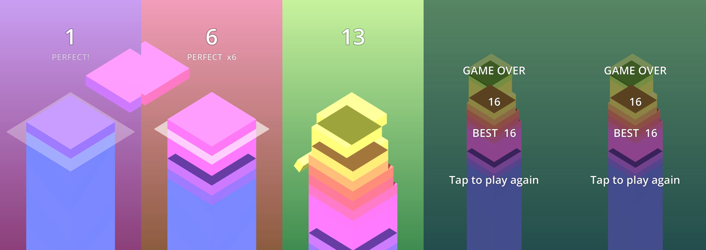

# Stack Tower 3D

A block slides back and forth above the tower. Tap to drop it. Whatever hangs over the edge is cut off and falls, so the next block is smaller. Miss completely and it's game over.

## Features

- 3D isometric view; the camera follows the tower and zooms out on game over
- **Perfect** drops (within 0.15 units) flash and count a streak; from 3 in a row, blocks grow back
- Speed rises with every level
- Colours and the gradient sky change with every level
- Sound effects generated in code (no audio files), vibration on Android
- Best score saved on the device
- Uses the Compatibility renderer, so it runs on low-end phones and in the browser

## Controls

Tap the screen (or press Space/Enter on a PC).

## Run it

**On a PC:** install Godot 4.3 or newer, open Godot, choose *Import*, select `stack-tower/project.godot`, then press Play (F5).

**On an Android phone:** install *Godot Engine* from the Play Store, copy the `stack-tower` folder to the phone, import `project.godot` in the app, then press Play.

## Make an APK

In Godot: *Editor → Manage Export Templates → Download*, then *Project → Export → Android → Export Project*. The Android SDK/JDK must be set in *Editor Settings → Export → Android*. An Android and a Web preset are already included.

## Code

Everything is in `main.gd`; the scene and the UI are built in code. Tune the game with the constants at the top of the file (`BLOCK_H`, `MOVE_RANGE`, `PERFECT_TOL`, `BASE_SPEED`, ...).
